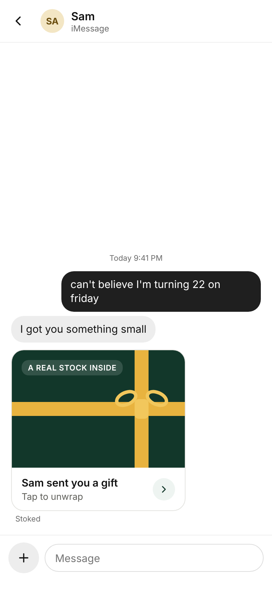
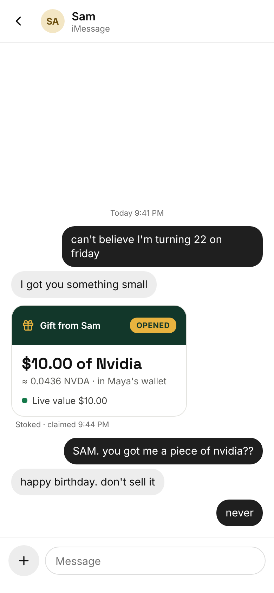
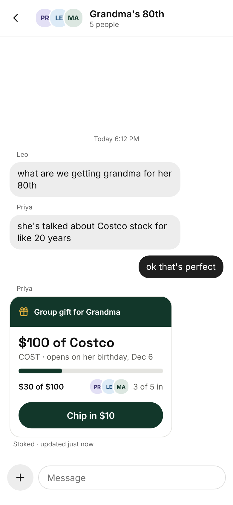

# Stoked

**Stock gifts that live in the conversation.** Send a friend $10 of Nvidia. It shows up in the chat as a wrapped present, they unwrap it, and a tokenized share lands in their wallet.

> **Status:** planning. Mockups and a build plan exist; no product code yet. The target is a Solana **devnet** demo using test tokens with no monetary value.

| Pick a gift | Wrapped | Unwrapped |
|---|---|---|
|  |  |  |

| Claimed | Group chip-in |
|---|---|
|  |  |

These are mockups. Names, messages and prices are sample content.

## How it works

1. **Pick** a stock, an amount, a note, and whether it opens now or on a date.
2. **Wrap** it. A gift card appears in the thread with its contents hidden.
3. **Unwrap** it, then claim the tokens or swap for a different stock first.
4. **Watch** the same card show the gift's current state and value.

Stock gift links already exist. Stoked's difference is the conversation: the gift is an object in the thread, where friends can see it change state.

## Planned stack

| Part | Choice |
|---|---|
| Tokens | Solana Token-2022 devnet mints with Scaled UI Amount, the extension xStocks use to represent dividends and splits |
| API and web app | Next.js and TypeScript, deployed on Vercel |
| Data | Supabase Postgres |
| iMessage | Swift extension (`MSMessageLiveLayout`), if a Mac is available; the web gift page works either way |

In the first version, a server-held treasury funds gifts and sends the transfers. Senders and contributors don't pay. An on-chain escrow is planned once the basic flow works.

## Limits

- Devnet only. Test tokens are not securities and have no value.
- Tokenized US stocks such as xStocks are only offered to eligible people outside the US. A real-money version would need eligibility checks and legal review.
- Anyone holding a gift's claim link can claim it.

## Docs

- [Build plan](docs/build-plan.md): architecture, contracts, schedule, risks
- [Agent goals](docs/goals.md): ready-to-run `/goal` statements
- [Design](docs/design.md): screens, tokens, motion
- [CLAUDE.md](CLAUDE.md): rules for coding agents

## Built before vs. during the hackathon

Dev3pack (Nov 27–29, 2026) allows earlier work and asks teams to be transparent about it.

- **Before Nov 27:** concept, mockups, build plan. *Update this as work lands.*
- **During:** *to be filled in.*
