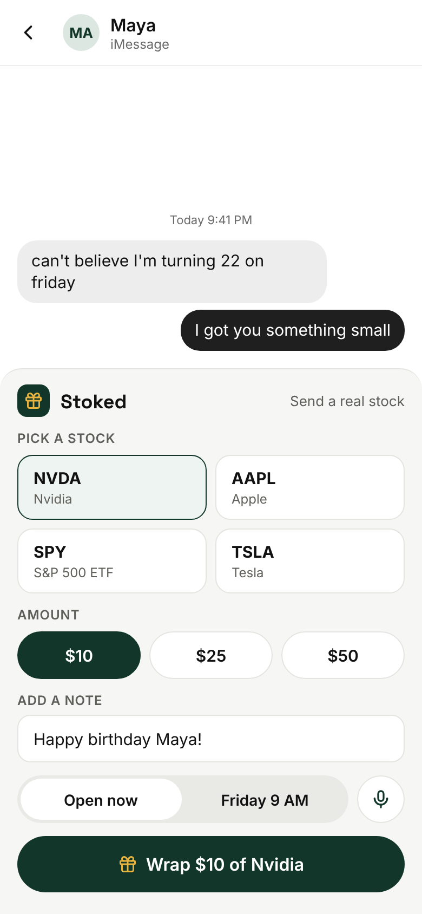
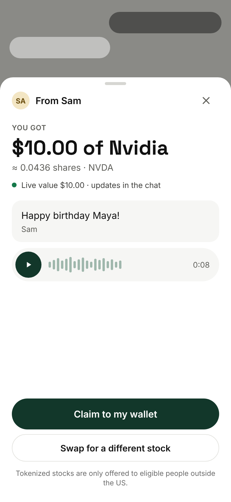

# Stoked

**Stock gifts that live in the conversation.** Send a friend $10 of Nvidia. They get a wrapped present, unwrap it, and test tokens that track the stock land in their wallet.

**Live demo:** https://stoked-ebon.vercel.app

> **Status:** the web flow works end to end on Solana **devnet**: send, unwrap, swap and claim. The tokens are test tokens with no monetary value, and prices are fixed demo prices. The iMessage app and on-chain escrow are not built.

## What works today

1. **Pick** a stock (NVDA, AAPL, SPY, TSLA or COST), $10, $25 or $50, a note, and whether it opens now or later.
2. **Wrap** it and send the private link. The link preview shows a wrapped card without the contents.
3. **Unwrap** it, swap for a different stock if you like, then **claim** it. The browser creates a wallet whose private key can't be exported, and the server sends the tokens to it.
4. **Watch**: the sender's page updates as the gift is opened and claimed, and the wallet page shows the holdings.

A claim is built never to pay twice: the transaction signature is stored before sending and checked before any retry.

## Design mockups

| Pick a gift | Wrapped | Unwrapped |
|---|---|---|
|  |  |  |

| Claimed | Group chip-in |
|---|---|
|  |  |

These are mockups, not screenshots. Names, messages and prices are sample content. The in-chat card and group chip-in are not built.

Stock gift links already exist. What Stoked is aiming for is the conversation: the gift as an object in the thread, where friends can see it change state.

## Stack

| Part | Choice |
|---|---|
| Tokens | Solana Token-2022 devnet mints with Scaled UI Amount, the extension xStocks use to represent dividends and splits |
| API and web app | Next.js and TypeScript, deployed on Vercel |
| Data | Supabase Postgres, readable and writable only by the server |

A server-held treasury funds gifts and sends the transfers; senders don't pay. There is no on-chain program yet.

## Run the checks

Needs Node 22 or later and pnpm. The browser tests also need the Solana CLI (`solana-test-validator`) and Playwright's Chromium.

```sh
pnpm install
pnpm lint && pnpm typecheck && pnpm test
pnpm --filter @stoked/web exec playwright install chromium
pnpm test:e2e
```

Devnet setup, mint addresses and the deployed smoke test are in [docs/devnet.md](docs/devnet.md).

## Limits

- Devnet only. Test tokens are not securities and have no value.
- Prices are fixed demo values, not market data.
- Gifts are funded by the treasury, and nothing is held in escrow.
- Anyone holding a gift's claim link can claim it.
- The recipient's wallet lives only in their browser. Clearing site data loses it.
- Not yet tested in Safari or on a phone.
- Tokenized US stocks such as xStocks are only offered to eligible people outside the US. A real-money version would need eligibility checks and legal review.

## Docs

- [Build plan](docs/build-plan.md): architecture, contracts, schedule, risks
- [Devnet](docs/devnet.md): addresses, setup, verification
- [Design](docs/design.md): screens, tokens, motion
- [Agent goals](docs/goals.md): ready-to-run `/goal` statements
- [CLAUDE.md](CLAUDE.md): rules for coding agents

## Built before vs. during the hackathon

Dev3pack (November 27–29, 2026) allows earlier work and asks teams to be transparent about it. We found dates but no start time, so the line is drawn at a commit.

### Before

Everything up to commit [`80a54c8`](https://github.com/brockbenton/stoked/commit/80a54c83a910e23f49b0b4fd3d39fcbecdbab9a3), merged 2026-11-27 at 01:19 UTC. Commits since then change only documentation unless listed under "During".

| Work | Pull request |
|---|---|
| Concept, mockups, build plan | [#1](https://github.com/brockbenton/stoked/pull/1) |
| Workspace, shared contracts, database schema, CI | [#2](https://github.com/brockbenton/stoked/pull/2) |
| Token-2022 mints, multiplier handling, claim transfer | [#3](https://github.com/brockbenton/stoked/pull/3) |
| Gift web UI | [#4](https://github.com/brockbenton/stoked/pull/4) |
| Gift API and claim protocol | [#5](https://github.com/brockbenton/stoked/pull/5) |
| UI connected to the API, browser wallet, browser tests | [#6](https://github.com/brockbenton/stoked/pull/6) |
| Devnet deployment, smoke test, value rounding, UI label removal | [#7](https://github.com/brockbenton/stoked/pull/7) |

At that commit, the smoke test passed on the live site ([claim transaction](https://explorer.solana.com/tx/48ojBPUCFYrJ8A5HEqkGbsz7WzdV4gnWYjAgZCzhmSEfdwp4msK51fNJFM3uGRv1JKjnZp55skccoFBxi348mCUv?cluster=devnet)).

### During

Nothing yet.
